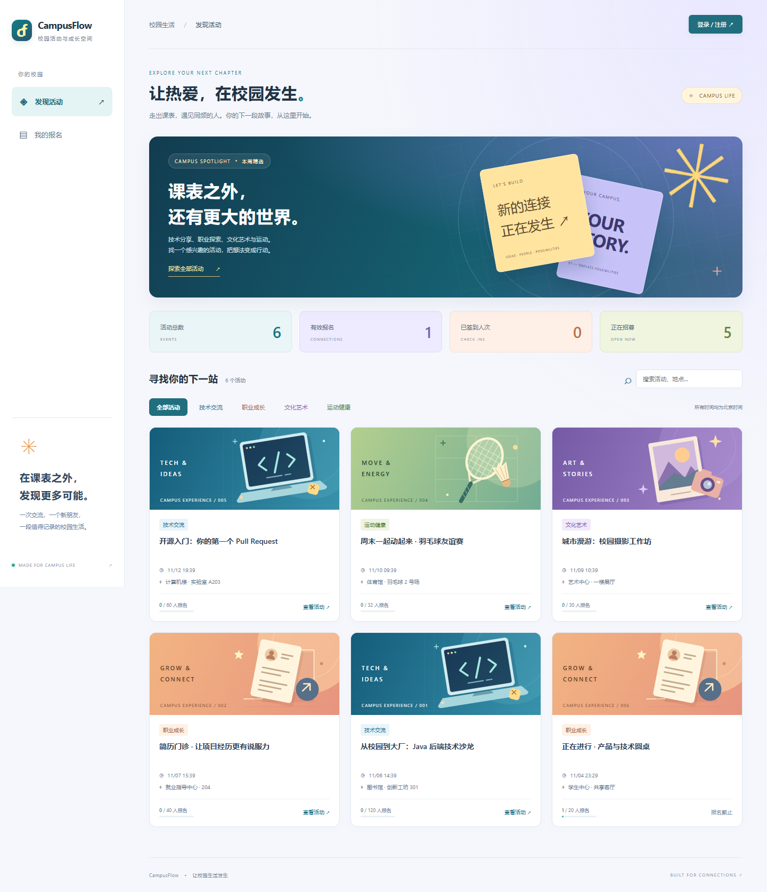
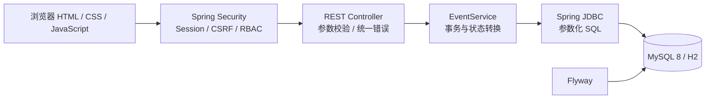
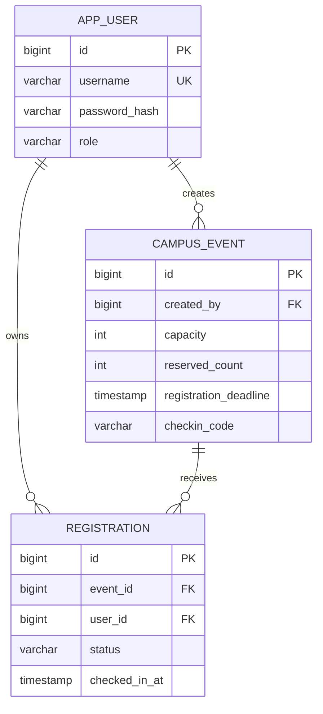

# CampusFlow · 校园活动报名与签到平台

[](https://github.com/219411-bot/campusflow/actions/workflows/ci.yml)


基于 Java 17、Spring Boot 与 MySQL 的校园活动报名与签到平台：学生发现活动、报名与现场签到，管理员发布活动、查看名单和签到码。包含可交互网页、数据库事务、权限控制、自动化集成测试和部署配置。

重点是把「最后一个名额被同时争抢」「取消后名额恢复」「重复请求不能重复报名」「只能操作自己的报名」这些业务问题做完整。



## 功能

| 学生与访客 | 管理员 | 工程实践 |
| --- | --- | --- |
| 活动搜索、分类、分页、详情 | 发布活动与设置容量 | Spring Security + BCrypt |
| 注册、登录、退出 | 查看报名与签到状态 | Session、CSRF、角色权限 |
| 报名、取消原因、截止前重报 | 两分钟签到码与校园身份核验 | 事务、共享/独占锁、联合唯一约束 |
| 分页报名与操作历史、现场签到 | 活动取消、名单分页与操作流水 | Flyway 迁移、接口限流、统一异常响应 |
| 桌面与手机网页 | 学生接口不暴露签到码 | H2 / MySQL 集成测试与 CI |

## 快速运行：不需要先装数据库

需要 **JDK 17+、Maven 3.9+**。

```bash
git clone https://github.com/219411-bot/campusflow.git
cd campusflow
mvn spring-boot:run
```

打开 [http://localhost:8080](http://localhost:8080)。默认 `demo` profile 使用本地 H2 文件数据库，数据保存在 `data/`，首次启动会自动建表并插入 6 场活动。前后端同一个进程，不需要 npm。

| 演示角色 | 用户名 | 密码 |
| --- | --- | --- |
| 学生 | `student` | `Student123!` |
| 管理员 | `admin` | `Admin123!` |

演示学生已核验并报名「正在进行 · 产品与技术圆桌」。管理员在其名单页点击「生成 / 更新两分钟签到码」，学生在有效期内输入该码签到；超时后重新生成，旧码立即失效。新注册学生须先由管理员在线下核对校园名册/证件，再在「校园身份核验」页面记录唯一学号，才能报名。演示身份不代表真实学校认证。

H2 模式用于快速体验；学习 MySQL 事务与部署时使用下面的 MySQL 模式。

## MySQL 运行方式

### Docker Compose

需要 Docker Engine / Docker Desktop 已启动。

```bash
cp .env.example .env
# Windows PowerShell 可使用：Copy-Item .env.example .env
# 编辑 .env，替换两个数据库密码
docker compose up --build -d
```

打开 [http://localhost:8080](http://localhost:8080)。Compose 包含 MySQL 8.4、健康检查和应用；数据库不对主机暴露端口，网页仅绑定本机地址。停止使用 `docker compose down`，数据库保留在 Docker volume。

### 已有 MySQL 8.0.16+

创建独立数据库与应用用户，在终端交互输入密码，不把真实凭据提交到 Git：

```sql
CREATE DATABASE campusflow CHARACTER SET utf8mb4 COLLATE utf8mb4_unicode_ci;
-- 使用你自己的密码替换下面的占位符
CREATE USER 'campusflow'@'localhost' IDENTIFIED BY 'replace-with-your-password';
GRANT ALL PRIVILEGES ON campusflow.* TO 'campusflow'@'localhost';
```

PowerShell：

```powershell
$env:SPRING_PROFILES_ACTIVE = 'mysql'
$env:DB_USERNAME = 'campusflow'
$env:DB_PASSWORD = '你的数据库密码'
$env:SEED_DEMO = 'true'
$env:COOKIE_SECURE = 'false' # 仅本地 HTTP；HTTPS 部署设置为 true
mvn spring-boot:run
```

Linux / macOS：

```bash
export SPRING_PROFILES_ACTIVE=mysql
export DB_USERNAME=campusflow
export DB_PASSWORD='你的数据库密码'
export SEED_DEMO=true
export COOKIE_SECURE=false
mvn spring-boot:run
```

可选 `DB_URL`、`PORT`。Flyway 在启动时自动执行 `src/main/resources/db/migration/` 中的 SQL。所有业务时间按 `Asia/Shanghai` 处理。

`mysql` profile 默认不创建演示账号。上面的本地演示命令显式开启了种子数据；种子仅在用户表为空时初始化。对外部署前应关闭演示种子、替换/移除已创建的默认账户，配置 HTTPS 与 Secure cookie，并完善管理员初始化、可信校园身份来源和网关多实例限流等生产措施。已有 demo 数据库升级后不会重写原账号，学生需由管理员完成一次身份核验。

## 后端设计



### 报名如何防止超卖

`EventService.register()` 在单个 `@Transactional` 事务内完成：

1. `SELECT ... FOR UPDATE` 锁定活动行。
2. 校验报名截止时间、已有报名状态、剩余容量。
3. 更新 `reserved_count` 并插入报名；已取消的记录则复用原记录。
4. 任一步失败都会回滚。取消与签到也按「活动行 → 报名记录」的顺序加锁；MySQL 签到使用 `FOR SHARE`，其余活动写操作使用 `FOR UPDATE`。

数据库另有 `UNIQUE(event_id, user_id)`、校园学号唯一索引、外键与容量 CHECK 约束。报名与取消仍会串行修改同一活动的容量；不同学生的 MySQL 签到可并行，活动取消和码轮换仍与签到互斥。详见 [实测性能、锁等待与查询计划](docs/PERFORMANCE.md)，测量是本地事务服务负载，不是网站生产 QPS。

### 表结构



状态转换：`REGISTERED → CANCELLED → REGISTERED`；`REGISTERED → ATTENDED`。学生只能在开始前取消；管理员可在结束前取消整场活动并填写原因，未签到报名释放名额，已签到记录保留。每次变化在同一事务写入 `operation_log`，重报不会覆盖过往流水。活动生命周期按时间显示报名开放、报名截止、进行中、已结束，取消状态永久保存。

## 测试与打包

```bash
mvn verify
java -jar target/campusflow-1.0.0.jar
```

集成测试覆盖登录/退出、CSRF、角色权限、用户数据隔离、参数校验、身份核验、短时码轮换/过期、活动取消及历史、列表分页。额外测试通过数据库约束故障制造「名额已更新，插入报名失败」，验证数据库事务真正回滚。并发测试使用线程池与同步栅栏：

- 30 个不同用户同时争抢 5 个名额：断言成功 5 次、冲突 25 次、数据库有效报名与计数均为 5。
- 同一用户并发发起 12 次报名：断言仅一次成功、只生成一条记录、只扣一个名额。
- 96 个任务多轮交错报名、取消、签到：核对当前人数、有效报名、签到状态与流水收支。
- 活动取消与报名、签到竞争：验证已取消后不再产生有效新报名，已签到记录不被取消覆盖。

本地默认测试使用内存 H2；GitHub Actions 在 H2 与 MySQL 8.4 上执行同一套测试。可对专用的空 MySQL 测试库设置 `TEST_DB_URL`、`TEST_DB_USERNAME`、`TEST_DB_PASSWORD` 后运行 `mvn verify`。测试会清空测试库内的业务表，请只使用专用测试库。

## 代码入口与资料

```text
src/main/java/dev/campusflow/
├── ApiController.java       # REST 接口与身份绑定
├── EventService.java        # 报名、取消、签到事务
├── SecurityConfig.java      # 认证、角色、CSRF
├── Models.java              # DTO 与校验
├── ApiException.java        # 统一错误处理
└── DemoData.java            # 首次启动演示数据
src/main/resources/
├── db/migration/            # 数据库版本管理
└── static/                 # 同源网页，无前端构建依赖
src/test/                   # HTTP、业务与并发集成测试
```

- [接口文档与状态规则](docs/API.md)
- [身份核验、限流与防代签边界](docs/SECURITY.md)
- [性能实测与 EXPLAIN ANALYZE](docs/PERFORMANCE.md)
- [我的报名页面](docs/screenshots/my-registrations.png)
- [管理员名单与签到码](docs/screenshots/admin.png)
- [手机页面](docs/screenshots/mobile.png)

这是个人练习与演示项目，没有真实学校接入、生产用户量或第三方支付。欢迎在理解实现后继续扩展。
