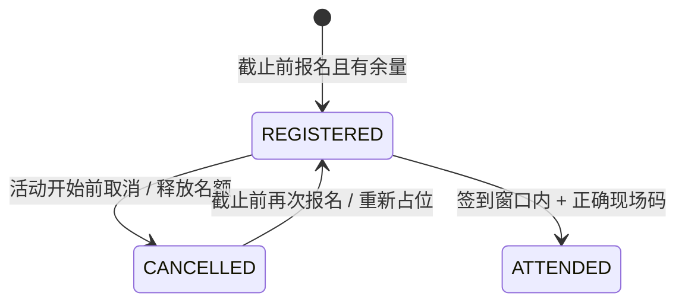

# HTTP API

基础地址：`http://localhost:8080/api`。JSON 字段使用 camelCase。时间均使用北京时间 `yyyy-MM-dd'T'HH:mm:ss`，前端显示也固定为北京时间。列表参数从 `page=0` 开始，`size` 范围为 1–50。

## 登录方式与请求安全

使用 Spring Security 的服务端 Session。浏览器通过 `HttpOnly` 的 `JSESSIONID` cookie 保持登录；所有写请求均必须附带 CSRF token。登录与退出后需要重新获取 token。

1. `GET /auth/csrf`，保存响应里的 `token`，同时保存 cookie。
2. `POST /auth/login`，Content-Type 为 `application/x-www-form-urlencoded`，字段 `username`、`password`，请求头附带 `X-XSRF-TOKEN`。
3. 再次 `GET /auth/csrf`，后续写请求使用新 token，所有请求携带同一组 cookie。
4. `POST /auth/logout` 使 Session 失效。

这里选择 Session 是因为网页与后端同源，便于撤销登录且无需在 localStorage 中存储长期凭证。不是 JWT 实现。

## 接口清单

| 方法 | 路径 | 权限 | 说明 |
| --- | --- | --- | --- |
| GET | `/auth/csrf` | 公开 | 获取写请求 token |
| POST | `/auth/register` | 公开 + CSRF | 注册学生账号 |
| POST | `/auth/login` | 公开 + CSRF | 表单登录 |
| POST | `/auth/logout` | 登录 + CSRF | 退出登录 |
| GET | `/auth/me` | 登录 | 当前用户，不返回密码 |
| GET | `/events?search=&category=&page=0&size=9` | 公开 | 搜索、分类和分页 |
| GET | `/events/{id}` | 公开 | 活动详情，不含签到码 |
| GET | `/stats` | 公开 | 活动数、有效报名数、签到数、开放活动数 |
| GET | `/registrations` | 登录 | 仅自己的报名记录，含取消记录 |
| POST | `/events/{id}/registrations` | 登录 + CSRF | 报名，占用一个名额 |
| DELETE | `/events/{id}/registrations` | 登录 + CSRF | 取消自己的报名 |
| POST | `/events/{id}/check-in` | 登录 + CSRF | 通过现场码签到 |
| POST | `/admin/events` | 管理员 + CSRF | 发布活动 |
| GET | `/admin/events/{id}/attendees` | 管理员 | 报名名单，含取消记录 |
| GET | `/admin/events/{id}/checkin-code` | 管理员 | 获取现场签到码 |

注册请求：

```json
{"username":"alice","password":"Example123!","fullName":"小林"}
```

活动发布请求（日期需替换为未来）：

```json
{
  "title": "Java 技术沙龙",
  "category": "TECH",
  "description": "从请求处理到事务提交，完成一个报名接口。",
  "location": "计算机楼 A203",
  "startsAt": "2030-03-12T14:00:00",
  "endsAt": "2030-03-12T16:00:00",
  "registrationDeadline": "2030-03-11T18:00:00",
  "capacity": 50
}
```

分类：`TECH`、`CAREER`、`CULTURE`、`SPORT`。签到请求：`{"code":"现场提供的8位码"}`。

分页响应：

```json
{"items":[],"total":0,"page":0,"size":9}
```

错误统一包含 `message`。状态码：400 参数或签到码错误；401 未登录；403 无权限或 CSRF 失败；404 活动不存在；409 重复报名、满额、时间限制或状态冲突；500 服务内部异常（详细信息只写日志）。注册与发布成功返回 201。

## 状态规则



签到窗口为开始前 30 分钟至结束时刻，结束时刻包含在窗口中。取消必须在开始时刻之前。报名必须在报名截止时刻之前。已签到占用原名额，不可取消或重复签到。报名、取消与签到操作统一先锁定活动行。
